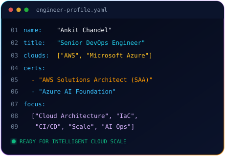

  

  

  <a href="#identity"><code>01. Identity</code></a> &nbsp;·&nbsp;
  <a href="#pillars"><code>02. Engineering Pillars</code></a> &nbsp;·&nbsp;
  <a href="#universe"><code>03. Cloud Universe</code></a> &nbsp;·&nbsp;
  <a href="#certifications"><code>04. Certifications</code></a> &nbsp;·&nbsp;
  <a href="#architecture"><code>05. Architecture</code></a> &nbsp;·&nbsp;
  <a href="#telemetry"><code>06. Telemetry</code></a> &nbsp;·&nbsp;
  <a href="#connect"><code>07. Connect</code></a>

  

## 🛸 Command Identity — About Me

<table>
  <tr>
    <td width="44%" align="center" valign="middle">
      
    </td>
    <td width="56%" valign="top">
      <h3>Engineering Modern Cloud &amp; AI-Driven Infrastructure</h3>
      

        I'm <strong>Ankit Chandel</strong>, a <strong>Senior DevOps Engineer</strong> holding both the
        <strong>AWS Certified Solutions Architect – Associate</strong> and the
        <strong>Azure AI Foundation Certificate</strong>.
      

      

        I am passionate about <strong>cloud architecture</strong>, <strong>infrastructure automation</strong>,
        <strong>CI/CD engineering</strong>, <strong>scalability</strong>, <strong>reliability</strong>, and
        <strong>AI-driven innovation</strong>—focused on designing and automating modern, resilient cloud platforms across
        <strong>Microsoft Azure</strong> and <strong>Amazon Web Services</strong>.
      

      <ul>
        <li><strong>Cloud Architecture:</strong> Designing scalable, fault-tolerant infrastructure across AWS and Azure ecosystems.</li>
        <li><strong>Infrastructure as Code &amp; Automation:</strong> Eliminating manual drift through declarative IaC, configuration automation, and self-healing pipelines.</li>
        <li><strong>CI/CD &amp; Container Platforms:</strong> Delivering reliable software supply chains powered by Kubernetes, GitOps, and automated quality gates.</li>
        <li><strong>Intelligent Operations:</strong> Exploring Azure AI services and Python/Bash automation to power smarter infrastructure workflows.</li>
      </ul>
    </td>
  </tr>
</table>

  

## ⚙️ Core Engineering Pillars

> How modern cloud infrastructure, automation pipelines, and intelligent workflows come together in practice.

<table>
  <tr>
    <td width="50%" valign="top">
      <h4>🌐 Multi-Cloud Architecture &amp; Networking</h4>
      

        Designing isolated, high-availability foundations across <strong>AWS</strong> and <strong>Microsoft Azure</strong>.
        This starts with non-overlapping CIDR segmentation (<code>VPC</code> / <code>VNet</code>), multi-AZ availability,
        controlled ingress/egress via <code>Load Balancers</code>, <code>Application Gateway</code>, and <code>Route 53</code>,
        and zero-trust identity boundaries enforced through <code>AWS IAM</code>, <code>Microsoft Entra ID</code>, and <code>Azure Key Vault</code>.
      

    </td>
    <td width="50%" valign="top">
      <h4>🧱 Infrastructure as Code &amp; Drift Prevention</h4>
      

        Treating every cloud resource as versioned, peer-reviewed code rather than manual console clicks.
        Using modular <strong>Terraform</strong> and <strong>CloudFormation</strong> templates with remote state locking,
        environment parity across Dev/Staging/Production, and <strong>Ansible</strong> for deterministic host configuration—so
        environments remain reproducible, auditable, and resilient against configuration drift.
      

    </td>
  </tr>
  <tr>
    <td width="50%" valign="top">
      <h4>🚀 CI/CD Pipelines &amp; GitOps Delivery</h4>
      

        Building automated software delivery highways across <strong>GitHub Actions</strong>, <strong>Azure DevOps</strong>,
        <strong>GitLab CI/CD</strong>, and <strong>Jenkins</strong>. Every commit flows through automated validation, container packaging
        with <strong>Docker</strong> into <code>ECR</code> or <code>ACR</code>, templated deployments with <strong>Helm</strong>,
        and continuous Git-driven reconciliation on <strong>EKS</strong> and <strong>AKS</strong> using <strong>ArgoCD</strong>.
      

    </td>
    <td width="50%" valign="top">
      <h4>🤖 Observability &amp; AI-Powered Operations</h4>
      

        Pairing full-stack telemetry (<strong>AWS CloudWatch</strong>, <strong>Azure Monitor</strong>, and
        <strong>Application Insights</strong>) with automation scripts in <strong>Python</strong> and <strong>Bash</strong>.
        By combining structured logs, metrics, and health signals with <strong>Azure AI Services</strong>, operational
        workflows can move beyond static alerts toward intelligent diagnostics, automated triage, and proactive scaling.
      

    </td>
  </tr>
</table>

  

## 🌌 Cloud Technology Universe

> Structured by ecosystem so technologies can be added, updated, or removed cleanly as skills evolve.

<!-- TIP: To edit any technology card, add, update, or remove a <td>...</td> cell within the corresponding table below. -->

###  Microsoft Azure

  Core Azure compute, container orchestration, hub-and-spoke networking, identity governance, observability, data, and AI building blocks used to engineer secure enterprise-ready platforms:

<table>
  <tr>
    <td align="center" width="25%">
       
      <strong>Azure Virtual Machines</strong>
    </td>
    <td align="center" width="25%">
       
      <strong>Azure Kubernetes Service (AKS)</strong>
    </td>
    <td align="center" width="25%">
       
      <strong>Azure Container Registry</strong>
    </td>
    <td align="center" width="25%">
       
      <strong>Azure App Service</strong>
    </td>
  </tr>
  <tr>
    <td align="center" width="25%">
       
      <strong>Azure Functions</strong>
    </td>
    <td align="center" width="25%">
       
      <strong>Azure Virtual Network</strong>
    </td>
    <td align="center" width="25%">
       
      <strong>Azure Load Balancer</strong>
    </td>
    <td align="center" width="25%">
       
      <strong>Azure Application Gateway</strong>
    </td>
  </tr>
  <tr>
    <td align="center" width="25%">
       
      <strong>Azure Key Vault</strong>
    </td>
    <td align="center" width="25%">
       
      <strong>Azure Monitor</strong>
    </td>
    <td align="center" width="25%">
       
      <strong>Application Insights</strong>
    </td>
    <td align="center" width="25%">
       
      <strong>Azure Storage Accounts</strong>
    </td>
  </tr>
  <tr>
    <td align="center" width="25%">
       
      <strong>Azure SQL Database</strong>
    </td>
    <td align="center" width="25%">
       
      <strong>Azure DevOps</strong>
    </td>
    <td align="center" width="25%">
       
      <strong>Microsoft Entra ID</strong>
    </td>
    <td align="center" width="25%">
       
      <strong>Azure AI Services</strong>
    </td>
  </tr>
</table>

 

###  Amazon Web Services

  Foundational AWS services for scalable compute, Kubernetes and container workloads, network isolation, least-privilege IAM, serverless event execution, and automated operations:

<table>
  <tr>
    <td align="center" width="20%">
       
      <strong>EC2</strong>
    </td>
    <td align="center" width="20%">
       
      <strong>S3</strong>
    </td>
    <td align="center" width="20%">
       
      <strong>IAM</strong>
    </td>
    <td align="center" width="20%">
       
      <strong>VPC</strong>
    </td>
    <td align="center" width="20%">
       
      <strong>EKS</strong>
    </td>
  </tr>
  <tr>
    <td align="center" width="20%">
       
      <strong>ECS</strong>
    </td>
    <td align="center" width="20%">
       
      <strong>ECR</strong>
    </td>
    <td align="center" width="20%">
       
      <strong>Lambda</strong>
    </td>
    <td align="center" width="20%">
       
      <strong>CloudWatch</strong>
    </td>
    <td align="center" width="20%">
       
      <strong>CloudFormation</strong>
    </td>
  </tr>
  <tr>
    <td align="center" width="20%">
       
      <strong>Route 53</strong>
    </td>
    <td align="center" width="20%">
       
      <strong>RDS</strong>
    </td>
    <td align="center" width="20%">
       
      <strong>Systems Manager</strong>
    </td>
    <td align="center" width="20%"></td>
    <td align="center" width="20%"></td>
  </tr>
</table>

 

###  DevOps &amp; Infrastructure Automation

  Cloud-agnostic toolchain for containerization, cluster orchestration, declarative provisioning, configuration management, CI/CD pipelines, and GitOps continuous delivery:

<table>
  <tr>
    <td align="center" width="25%">
       
      <strong>Docker</strong>
    </td>
    <td align="center" width="25%">
       
      <strong>Kubernetes</strong>
    </td>
    <td align="center" width="25%">
       
      <strong>Terraform</strong>
    </td>
    <td align="center" width="25%">
       
      <strong>Ansible</strong>
    </td>
  </tr>
  <tr>
    <td align="center" width="25%">
       
      <strong>Jenkins</strong>
    </td>
    <td align="center" width="25%">
       
      <strong>GitHub Actions</strong>
    </td>
    <td align="center" width="25%">
       
      <strong>GitLab CI/CD</strong>
    </td>
    <td align="center" width="25%">
       
      <strong>Helm</strong>
    </td>
  </tr>
  <tr>
    <td align="center" width="25%">
       
      <strong>ArgoCD</strong>
    </td>
    <td align="center" width="25%">
       
      <strong>Linux</strong>
    </td>
    <td align="center" width="25%">
       
      <strong>Git</strong>
    </td>
    <td align="center" width="25%"></td>
  </tr>
</table>

 

###  AI &amp; Automation

  Bridging traditional infrastructure scripting with modern AI services to build smarter, self-diagnosing, and automated operational pipelines:

<table>
  <tr>
    <td align="center" width="20%">
       
      <strong>Azure AI</strong>
    </td>
    <td align="center" width="20%">
       
      <strong>Python</strong>
    </td>
    <td align="center" width="20%">
       
      <strong>Bash</strong>
    </td>
    <td align="center" width="20%">
       
      <strong>Cloud Automation</strong>
    </td>
    <td align="center" width="20%">
       
      <strong>AI-Powered Infrastructure Workflows</strong>
    </td>
  </tr>
</table>

  
<strong>📖 Ecosystem Quick-Reference Guide (Click to expand role breakdown)</strong>

   
  <table>
    <tr>
      <th>Layer</th>
      <th>Azure Components</th>
      <th>AWS Components</th>
      <th>Architectural Purpose</th>
    </tr>
    <tr>
      <td><strong>Compute &amp; Containers</strong></td>
      <td>Virtual Machines, AKS, ACR, App Service, Functions</td>
      <td>EC2, EKS, ECS, ECR, Lambda</td>
      <td>Running containerized microservices, managed Kubernetes workloads, PaaS apps, and event-driven serverless functions.</td>
    </tr>
    <tr>
      <td><strong>Networking &amp; Edge</strong></td>
      <td>Virtual Network, Load Balancer, Application Gateway</td>
      <td>VPC, Route 53</td>
      <td>Segmenting traffic into isolated tiers, distributing load reliably, and managing DNS routing and Layer-7 ingress.</td>
    </tr>
    <tr>
      <td><strong>Identity &amp; Secrets</strong></td>
      <td>Microsoft Entra ID, Key Vault</td>
      <td>IAM</td>
      <td>Enforcing least-privilege RBAC, workload identity, and centralized secret/key lifecycle management.</td>
    </tr>
    <tr>
      <td><strong>Data &amp; Storage</strong></td>
      <td>Storage Accounts, Azure SQL Database</td>
      <td>S3, RDS</td>
      <td>Durable object storage with lifecycle controls and managed relational databases with automated backups.</td>
    </tr>
    <tr>
      <td><strong>Delivery &amp; Governance</strong></td>
      <td>Azure DevOps</td>
      <td>CloudFormation, Systems Manager</td>
      <td>Automated build/release pipelines, declarative infrastructure stacks, and centralized fleet/patch administration.</td>
    </tr>
    <tr>
      <td><strong>Observability &amp; AI</strong></td>
      <td>Azure Monitor, Application Insights, Azure AI Services</td>
      <td>CloudWatch</td>
      <td>Real-time telemetry, APM tracing, alerting, and intelligent AI-assisted operational automation.</td>
    </tr>
  </table>

  

## 🏅 Certifications & Credentials

  

 

<table>
  <tr>
    <td width="50%" valign="top">
      <h4>☁️ AWS Certified Solutions Architect – Associate</h4>
      

        Validates the ability to design and deploy scalable, highly available, cost-optimized, and fault-tolerant
        distributed systems on Amazon Web Services—covering VPC networking, IAM security boundaries, compute selection,
        and resilient storage architectures.
      

    </td>
    <td width="50%" valign="top">
      <h4>🧠 Azure AI Foundation Certificate</h4>
      

        Establishes foundational knowledge of artificial intelligence workloads and Microsoft Azure AI Services,
        enabling the integration of intelligent automation, cognitive capabilities, and AI-assisted workflows into
        modern cloud platforms.
      

    </td>
  </tr>
</table>

  

## 🛰️ Multi-Cloud Architecture Blueprint

  

 

### How the End-to-End Flow Works

| Stage | Pipeline / System Layer | What Happens &amp; Why It Matters |
| :--- | :--- | :--- |
| **01 · Source** | **Developer → GitHub** | Application code, Kubernetes manifests, and Terraform IaC modules are committed to version-controlled branches with pull request reviews and branch protection policies. |
| **02 · Automation** | **CI/CD Pipeline** | Automated workflows (GitHub Actions, Azure DevOps, GitLab CI/CD, Jenkins) run linting, validation, security checks, and build immutable Docker images pushed to `ECR` or `ACR`. |
| **03 · IaC Engine** | **Terraform** | Modular Terraform plans and applies cloud infrastructure deterministically across both **AWS** and **Microsoft Azure**, using remote state locking to keep environments consistent. |
| **04 · Cloud Ecosystems** | **AWS &amp; Azure Cloud** | **AWS** (`VPC`, `IAM`, `Route 53`, `EKS`, `ECS`, `EC2`, `S3`, `RDS`, `Lambda`) and **Azure** (`VNet`, `Entra ID`, `Key Vault`, `AKS`, `App Service`, `Storage`, `SQL`, `Functions`, `Azure AI`) operate as isolated, secure ecosystems. |
| **05 · Orchestration** | **Kubernetes &amp; GitOps** | Workloads run on managed **EKS** and **AKS** clusters, packaged with **Helm** and continuously reconciled against Git state via **ArgoCD** for predictable, self-healing deployments. |
| **06 · Observability &amp; AI** | **Monitoring &amp; AI Ops** | **AWS CloudWatch**, **Azure Monitor**, and **Application Insights** collect metrics, logs, and traces, feeding automated alerting and Python/Bash/Azure AI operational workflows. |

  

## 🌠 Contribution Constellation

  

  Automated daily via <a href="./.github/workflows/snake.yml"><code>.github/workflows/snake.yml</code></a> using <code>Platane/snk</code> to transform live GitHub contribution activity into a cosmic telemetry grid.

  

## 📡 Connect & Transmit

  <a href="https://www.linkedin.com/in/YOUR_LINKEDIN_HANDLE"><strong>🔗 LinkedIn (Update Handle)</strong></a>
  &nbsp;&nbsp;·&nbsp;&nbsp;
  <a href="https://github.com/ankitchandel198920"><strong>💻 GitHub (@ankitchandel198920)</strong></a>
  &nbsp;&nbsp;·&nbsp;&nbsp;
  <a href="mailto:ankitchandel@hotmail.com"><strong>✉️ ankitchandel@hotmail.com</strong></a>

  

